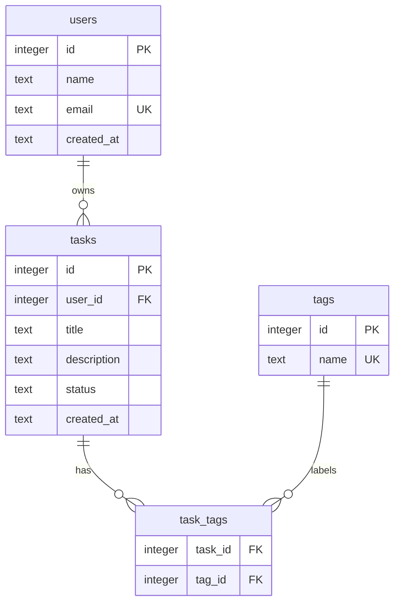

# M06 — SQL Fundamentals with SQLite

**Week 3 · Days 1-2 · 6 hours**

## Builds on

[m05-express-task-api-v1](../m05-express-task-api-v1/write-up-template.md) — the in-memory store from Task API v1 gets replaced by a real schema here, then by Prisma on top of it in M07.

## Learning Goals

By the end of this module, you should be able to:

- [ ] Explain the relational model: tables, rows, primary keys, foreign keys.
- [ ] Describe SQLite specifics: a single-file database, dynamic typing and type affinity, and why `PRAGMA foreign_keys` must be enabled per connection.
- [ ] Write DDL (`CREATE`/`ALTER`/`DROP`) with constraints (`PRIMARY KEY`, `NOT NULL`, `UNIQUE`, `CHECK`, `DEFAULT`, `FOREIGN KEY … ON DELETE`).
- [ ] Write DML (`INSERT`/`SELECT`/`UPDATE`/`DELETE`) with filtering, sorting, `LIMIT`/`OFFSET`, and explain keyset pagination.
- [ ] Use aggregates with `GROUP BY`/`HAVING`, `INNER` and `LEFT` joins, and subqueries.
- [ ] Model 1:1, 1:N and M:N relationships (the last with a junction table) and apply normalisation basics (1NF–3NF).
- [ ] Explain what an index is for and read `EXPLAIN QUERY PLAN` output.
- [ ] Use explicit transactions (`BEGIN`/`COMMIT`/`ROLLBACK`) and explain ACID.
- [ ] Explain SQL injection and why parameterised queries stop it.
- [ ] Document an ERD with Mermaid in a GitHub README.

## Concept

### The relational model

A relational database stores data in **tables** (relations). Each table is a fixed set of **columns**; each **row** is one record. Two keys make the model work:

- A **primary key** uniquely identifies a row within its table. It must be unique and non-null. In SQLite, `INTEGER PRIMARY KEY` is an alias for the internal `rowid`, so it auto-increments cheaply.
- A **foreign key** is a column whose values must match a primary key in another table. It is how one table points at another, and it is what lets the database refuse to store a task that belongs to no user.

The schema in this module is the Task API's data, modelled relationally: `users` own `tasks`, and `tasks` are labelled by `tags` through a `task_tags` junction table.

### SQLite specifics

- **Single file.** An entire database is one file (`tasks.db`). There is no server process — the `sqlite3` CLI and your application both just open the file. That is why SQLite is perfect for this program: nothing to install beyond the CLI.
- **Dynamic typing and type affinity.** SQLite columns have a *type affinity* (`INTEGER`, `TEXT`, `REAL`, `BLOB`, `NUMERIC`), not a hard type. A `TEXT` column will happily store the number `5` unless a constraint stops it. The `CHECK` constraint is therefore your real guarantee, not the column type.
- **`PRAGMA foreign_keys` is off by default.** SQLite parses foreign keys but does not enforce them unless you run `PRAGMA foreign_keys = ON;` — and that setting lasts for the current connection only. Set it at the top of every script and connection, or your `REFERENCES` clauses are decoration.

### DDL — defining structure

DDL (`Data Definition Language`) creates and changes structure:

- `CREATE TABLE`, `ALTER TABLE`, `DROP TABLE`.
- Constraints: `PRIMARY KEY` (unique + not null), `NOT NULL`, `UNIQUE`, `CHECK (expr)`, `DEFAULT value`, and `FOREIGN KEY (col) REFERENCES other(id) ON DELETE CASCADE`.
- `CREATE INDEX` speeds up lookups and joins on a column.

### DML — reading and writing data

DML (`Data Manipulation Language`) works with rows:

- `INSERT INTO … VALUES (…)`, `UPDATE … SET … WHERE …`, `DELETE FROM … WHERE …`.
- `SELECT` with `WHERE` (filter), `ORDER BY` (sort), and `LIMIT`/`OFFSET` (pagination).
- **Offset pagination** (`LIMIT n OFFSET k`) is simple but drifts: if rows are inserted or deleted between page requests, offset k no longer points at the same place, and it gets slower the deeper you page. **Keyset pagination** remembers the last row you saw and asks for rows after it (`WHERE id > :last_id ORDER BY id LIMIT n`). It is stable and constant-time, which is why the real Task API uses it.

### Aggregates, joins, subqueries

- **Aggregates** (`COUNT`, `SUM`, `AVG`, `MIN`, `MAX`, `GROUP_CONCAT`) collapse many rows into one. `GROUP BY` defines the groups; `HAVING` filters the groups *after* aggregation (unlike `WHERE`, which filters rows *before*).
- **Joins** combine tables. `INNER JOIN` keeps only rows that match on both sides. `LEFT JOIN` keeps every row from the left table and fills the right side with `NULL` when there is no match — that is how you find "users with no tasks" or "tasks with no tags".
- **Subqueries** are `SELECT`s nested inside another statement, used for membership (`IN`), existence (`EXISTS`/`NOT EXISTS`), or a single computed value (scalar subquery).

### Relationships and normalisation

- **1:N** — one row on the left, many on the right: a user has many tasks. The foreign key lives on the *many* side (`tasks.user_id`).
- **M:N** — many on both sides: a task has many tags, a tag has many tasks. You cannot express this with two columns, so you add a **junction table** (`task_tags`) whose rows are pairs `(task_id, tag_id)`, each a foreign key, with the pair as the primary key.
- **1:1** is just a 1:N where the foreign key is also `UNIQUE`.
- **Normalisation** removes duplicated data: 1NF (atomic values, no repeating groups), 2NF (no partial dependency on part of a composite key), 3NF (no transitive dependency — non-key columns depend only on the key). The junction table is the textbook normalised answer to M:N.

### Indexes and query plans

An **index** is a sorted structure the database keeps alongside a table so it can find rows without scanning the whole table. `EXPLAIN QUERY PLAN <query>` shows whether SQLite used one: look for `SCAN <table>` (bad, reads every row) versus `SEARCH <table> USING INDEX <name>` (good, jumps straight to matches). Indexes cost storage and slow writes slightly, so you add them for columns you filter or join on frequently.

### Transactions and ACID

A **transaction** groups statements into one all-or-nothing unit: `BEGIN`, then `COMMIT` to make it permanent or `ROLLBACK` to undo everything back to `BEGIN`. ACID describes the guarantees — **A**tomicity, **C**onsistency, **I**solation, **D**urability. You already rely on this: a transfer that debits one account must not credit another without committing both.

### SQL injection and parameterised queries

If you build SQL by concatenating strings — `"SELECT … WHERE title = '" + input + "'"` — an attacker controls the *SQL syntax*, not just a value. Sending `' OR '1'='1` turns your filter into a condition that is always true and dumps every row. The fix is **parameterised queries**: the SQL is sent with a placeholder (`?` or `:name`) and the values are bound separately, so input can never be parsed as SQL. This module makes you demonstrate both halves.

## Read These

- [SQLite — Documentation index](https://sqlite.org/docs.html) — the canonical source; skim the "SQL Syntax" list.
- [SQLite — CREATE TABLE](https://sqlite.org/lang_createtable.html) — constraints, `FOREIGN KEY`, `ON DELETE`, and column affinity.
- [SQLite — Datatypes in SQLite](https://sqlite.org/datatype3.html) — type affinity and dynamic typing.
- [SQLite — Foreign Key Support](https://sqlite.org/foreignkeys.html) — why `PRAGMA foreign_keys = ON` is required per connection.
- [SQLite — SELECT](https://sqlite.org/lang_select.html) — `WHERE`, `GROUP BY`, `HAVING`, `ORDER BY`, `LIMIT`/`OFFSET`, joins, subqueries.
- [SQLite — CREATE INDEX & Query Planning](https://sqlite.org/lang_createindex.html) and [EXPLAIN QUERY PLAN](https://sqlite.org/eqp.html) — how indexes turn `SCAN` into `SEARCH`.
- [SQLite — Transactions](https://sqlite.org/lang_transaction.html) — `BEGIN`/`COMMIT`/`ROLLBACK` and lock behaviour.
- [OWASP — SQL Injection](https://owasp.org/www-community/attacks/SQL_Injection) — the attack and the parameterised-query defence.
- [Mermaid — Entity Relationship Diagrams](https://mermaid.js.org/syntax/entityRelationshipDiagram.html) — syntax for the ERD you commit.

## Walkthrough(s)

### Walkthrough 1: Create the lab and the schema

Make a folder for this module's hand-built database and create the two SQL files you will build on. Each command below writes the file in full — copy and paste the whole block.

```bash
mkdir -p module-6-sql
cd module-6-sql
```

Create `schema.sql`:

```bash
cat > schema.sql << 'EOF'
PRAGMA foreign_keys = ON;

DROP TABLE IF EXISTS task_tags;
DROP TABLE IF EXISTS tasks;
DROP TABLE IF EXISTS tags;
DROP TABLE IF EXISTS users;

CREATE TABLE users (
  id         INTEGER PRIMARY KEY AUTOINCREMENT,
  name       TEXT    NOT NULL,
  email      TEXT    NOT NULL UNIQUE,
  created_at TEXT    NOT NULL DEFAULT (datetime('now'))
);

CREATE TABLE tasks (
  id          INTEGER PRIMARY KEY AUTOINCREMENT,
  user_id     INTEGER NOT NULL REFERENCES users(id) ON DELETE CASCADE,
  title       TEXT    NOT NULL,
  description TEXT,
  status      TEXT    NOT NULL DEFAULT 'todo'
              CHECK (status IN ('todo', 'in_progress', 'done')),
  created_at  TEXT    NOT NULL DEFAULT (datetime('now'))
);

CREATE TABLE tags (
  id   INTEGER PRIMARY KEY AUTOINCREMENT,
  name TEXT    NOT NULL UNIQUE
);

CREATE TABLE task_tags (
  task_id INTEGER NOT NULL REFERENCES tasks(id) ON DELETE CASCADE,
  tag_id  INTEGER NOT NULL REFERENCES tags(id)  ON DELETE CASCADE,
  PRIMARY KEY (task_id, tag_id)
);

CREATE INDEX idx_tasks_user_id ON tasks(user_id);
CREATE INDEX idx_task_tags_tag ON task_tags(tag_id);
EOF
```

Then create `seed.sql` with three users, four tags, seven tasks and the tag links:

```bash
cat > seed.sql << 'EOF'
PRAGMA foreign_keys = ON;

INSERT INTO users (id, name, email) VALUES
  (1, 'Alice Chen',  'alice@example.com'),
  (2, 'Ben Okafor',  'ben@example.com'),
  (3, 'Carla Ruiz',  'carla@example.com');

INSERT INTO tags (id, name) VALUES
  (1, 'urgent'),
  (2, 'backend'),
  (3, 'docs'),
  (4, 'design');

INSERT INTO tasks (id, user_id, title, description, status) VALUES
  (1, 1, 'Design schema',      'Draft the ERD',      'done'),
  (2, 1, 'Write migrations',   NULL,                 'in_progress'),
  (3, 1, 'Add auth',           'JWT in M07',         'todo'),
  (4, 2, 'Fix pagination bug', 'Off-by-one in page', 'in_progress'),
  (5, 2, 'Write API docs',     NULL,                 'todo'),
  (6, 3, 'Review PR',          'M06 checkpoint',     'done'),
  (7, 3, 'Set up CI',          NULL,                 'todo');

INSERT INTO task_tags (task_id, tag_id) VALUES
  (1, 1), (1, 2),
  (2, 2),
  (3, 2), (3, 4),
  (4, 2),
  (5, 3),
  (6, 1), (6, 3);
EOF
```

Build the database from both files, then confirm the four tables exist:

```bash
rm -f tasks.db
sqlite3 tasks.db < schema.sql
sqlite3 tasks.db < seed.sql
sqlite3 tasks.db ".tables"
```

Expected output:

```
tags       task_tags  tasks      users
```

Confirm the row counts:

```bash
sqlite3 -header -column tasks.db "SELECT COUNT(*) AS users FROM users; SELECT COUNT(*) AS tasks FROM tasks; SELECT COUNT(*) AS tags FROM tags; SELECT COUNT(*) AS task_tags FROM task_tags;"
```

```
users
-----
3
tasks
-----
7
tags
----
4
task_tags
---------
9
```

> Note: `task_tags` has 9 rows, not "one per task". Because a task can carry several tags, the junction table has one row per *link*, which is exactly the point of an M:N table.

### Walkthrough 2: Filtering, sorting and pagination

Open the database interactively for the rest of the walkthroughs:

```bash
sqlite3 tasks.db
```

At the `sqlite>` prompt, turn on headers and aligned columns so output is readable:

```sql
.headers on
.mode column
```

Find every `todo`, newest first:

```sql
SELECT id, title, status
FROM tasks
WHERE status = 'todo'
ORDER BY created_at DESC, id DESC;
```

```
id  title           status
--  --------------  ------
7   Set up CI       todo
5   Write API docs  todo
3   Add auth        todo
```

Page with `LIMIT`/`OFFSET` — "page 2" of 3 rows per page:

```sql
SELECT id, title FROM tasks ORDER BY id LIMIT 3 OFFSET 3;
```

```
id  title
--  ------------------
4   Fix pagination bug
5   Write API docs
6   Review PR
```

Now the same page with **keyset pagination** — remember the last `id` you saw (`3`) instead of counting rows:

```sql
SELECT id, title FROM tasks WHERE id > 3 ORDER BY id LIMIT 3;
```

```
id  title
--  ------------------
4   Fix pagination bug
5   Write API docs
6   Review PR
```

Same result, but keyset stays correct even if rows are added before page 2, and it does not get slower as you page deeper.

### Walkthrough 3: Joins and aggregates

`INNER JOIN` the owner's name onto each task. Only rows that match on both sides survive:

```sql
SELECT t.id, t.title, u.name AS owner
FROM tasks t
INNER JOIN users u ON u.id = t.user_id
ORDER BY t.id;
```

```
id  title               owner
--  ------------------  ----------
1   Design schema       Alice Chen
2   Write migrations    Alice Chen
3   Add auth            Alice Chen
4   Fix pagination bug  Ben Okafor
5   Write API docs      Ben Okafor
6   Review PR           Carla Ruiz
7   Set up CI           Carla Ruiz
```

Reach the tags through the junction table and use `LEFT JOIN` so that a task with no tags still appears (its tag is `NULL`):

```sql
SELECT t.id, t.title, tg.name AS tag
FROM tasks t
LEFT JOIN task_tags tt ON tt.task_id = t.id
LEFT JOIN tags tg ON tg.id = tt.tag_id
ORDER BY t.id, tg.name;
```

```
id  title               tag
--  ------------------  -------
1   Design schema       backend
1   Design schema       urgent
2   Write migrations    backend
3   Add auth            backend
3   Add auth            design
4   Fix pagination bug  backend
5   Write API docs      docs
6   Review PR           docs
6   Review PR           urgent
7   Set up CI
```

Row `7 Set up CI` has an empty tag — that is the `LEFT JOIN` keeping an unmatched left row. An `INNER JOIN` would have dropped it entirely.

Count tasks per owner and keep only owners with at least two, using `GROUP BY` + `HAVING`:

```sql
SELECT u.name AS owner, COUNT(*) AS task_count
FROM tasks t
JOIN users u ON u.id = t.user_id
GROUP BY u.id
HAVING COUNT(*) >= 2
ORDER BY task_count DESC, owner;
```

```
owner       task_count
----------  ----------
Alice Chen  3
Ben Okafor  2
Carla Ruiz  2
```

`GROUP_CONCAT` collapses each task's tag names into one string:

```sql
SELECT t.title, GROUP_CONCAT(tg.name, ', ') AS tags
FROM tasks t
JOIN task_tags tt ON tt.task_id = t.id
JOIN tags tg ON tg.id = tt.tag_id
GROUP BY t.id
ORDER BY t.id;
```

```
title               tags
------------------  ---------------
Design schema       urgent, backend
Write migrations    backend
Add auth            backend, design
Fix pagination bug  backend
Write API docs      docs
Review PR           urgent, docs
```

### Walkthrough 4: Subqueries

`IN` with a subquery — all tasks whose owner's name starts with "A":

```sql
SELECT id, title
FROM tasks
WHERE user_id IN (SELECT id FROM users WHERE name LIKE 'A%')
ORDER BY id;
```

```
id  title
--  ----------------
1   Design schema
2   Write migrations
3   Add auth
```

A **correlated** subquery — it is re-evaluated for each outer row, so it can also count:

```sql
SELECT u.name,
       (SELECT COUNT(*) FROM tasks t WHERE t.user_id = u.id) AS task_count
FROM users u
ORDER BY u.id;
```

```
name        task_count
----------  ----------
Alice Chen  3
Ben Okafor  2
Carla Ruiz  2
```

`NOT EXISTS` — tasks that have no tags at all:

```sql
SELECT t.id, t.title
FROM tasks t
WHERE NOT EXISTS (SELECT 1 FROM task_tags tt WHERE tt.task_id = t.id);
```

```
id  title
--  ---------
7   Set up CI
```

### Walkthrough 5: Indexes and `EXPLAIN QUERY PLAN`

`schema.sql` deliberately does **not** index `tasks.status`. Ask SQLite how it would find the `todo` rows:

```sql
EXPLAIN QUERY PLAN SELECT * FROM tasks WHERE status = 'todo';
```

```
QUERY PLAN
`--SCAN tasks
```

`SCAN tasks` means every row is read. Add an index:

```sql
CREATE INDEX idx_tasks_status ON tasks(status);
```

Run the plan again:

```sql
EXPLAIN QUERY PLAN SELECT * FROM tasks WHERE status = 'todo';
```

```
QUERY PLAN
`--SEARCH tasks USING INDEX idx_tasks_status (status=?)
```

`SEARCH … USING INDEX` means SQLite jumps straight to the matching rows — the plan above is why the index earns its place. You are still inside the `sqlite>` shell here, so make a note to append that same `CREATE INDEX idx_tasks_status …` statement to `schema.sql`; Walkthrough 8 shows the exact shell command for it.

### Walkthrough 6: Transactions

`BEGIN` a transaction, insert a row, and confirm it is visible inside the transaction — then `ROLLBACK` and watch the count return to 7:

```sql
BEGIN;
INSERT INTO tasks (user_id, title, status) VALUES (1, 'Temp task', 'todo');
SELECT COUNT(*) AS during_txn FROM tasks;
ROLLBACK;
SELECT COUNT(*) AS after_rollback FROM tasks;
```

```
during_txn
----------
8
after_rollback
--------------
7
```

Now commit instead of rolling back — the row survives:

```sql
BEGIN;
INSERT INTO tasks (user_id, title, status) VALUES (1, 'Kept task', 'todo');
COMMIT;
SELECT COUNT(*) AS after_commit FROM tasks;
```

```
after_commit
------------
8
```

### Walkthrough 7: SQL injection — the attack, then the fix

Exit the interactive shell (`.quit`) and run these from the shell, because the point is to show what happens when a program concatenates a value into SQL.

A web app that looked a task up by title might build this string. Set an attacker-supplied value and interpolate it into the query:

```bash
title="' OR '1'='1"
sqlite3 -header -column tasks.db "SELECT id, title, status FROM tasks WHERE title = '$title';"
```

The attacker's `' OR '1'='1` closes the string and adds a condition that is always true, so **every** row comes back:

```
id  title               status
--  ------------------  -----------
1   Design schema       done
2   Write migrations    in_progress
3   Add auth            todo
4   Fix pagination bug  in_progress
5   Write API docs      todo
6   Review PR           done
7   Set up CI           todo
```

Now send the same input as a **bound parameter** (`:title`) instead of pasting it into the SQL text:

```bash
sqlite3 -header -column tasks.db << 'EOF'
.parameter set :title "' OR '1'='1"
SELECT id, title, status FROM tasks WHERE title = :title;
EOF
```

No rows are returned — there is no task whose title is literally the string `' OR '1'='1`:

```
(no output — no rows matched)
```

The SQL text never changed; the value was bound separately, so it could only ever be compared as data, never parsed as syntax. In application code (for example `node:sqlite` or `better-sqlite3`) this is `db.prepare('SELECT … WHERE title = ?').get(title)`.

> Sanity check: the parameterised form still works for legitimate input. `.parameter set :title "Design schema"` returns task 1, exactly as the safe query should.

### Walkthrough 8: Persist the index and draw the ERD in Mermaid

You are back at the shell now (Walkthrough 7 ends with `.quit`). First, append the `status` index you added in Walkthrough 5 to `schema.sql`, so a fresh rebuild includes it:

```bash
cat >> schema.sql << 'EOF'

CREATE INDEX idx_tasks_status ON tasks(status);
EOF
```

Now document the schema you actually built. Create a README and paste this Mermaid block into it — GitHub renders ` ```mermaid ` fences natively. (The outer fence below uses four backticks so it can safely contain the three-backtick Mermaid fence inside the heredoc.)

````bash
cat > README.md << 'EOF'
# Task API — Database Schema (M06)



`tasks.user_id` is the 1:N foreign key (one user, many tasks). `task_tags` is the M:N
junction table: each row links one task to one tag, and the pair `(task_id, tag_id)` is the
primary key so the same tag cannot be attached twice.
EOF
````

Open `README.md` on GitHub (or the Mermaid Live Editor) and confirm the diagram matches the tables you created in `schema.sql`: `users`, `tasks`, `tags`, and the `task_tags` junction, with `tasks.user_id` pointing at `users.id` and both junction columns pointing at their parents.

## "What This Walkthrough Showed You"

- A relational schema is defined once in DDL and then queried endlessly in DML; the constraints (`NOT NULL`, `CHECK`, `UNIQUE`, `FOREIGN KEY`) are what actually protect the data, not the column types.
- `PRAGMA foreign_keys = ON` is per connection — forget it and `REFERENCES` is unenforced.
- `INNER JOIN` drops non-matching rows; `LEFT JOIN` keeps them and fills `NULL`, which is how you find missing relationships.
- `WHERE` filters rows before grouping; `HAVING` filters groups after aggregation.
- A subquery can feed `IN`, `EXISTS`, or a single value; a correlated subquery may be re-run per outer row.
- `EXPLAIN QUERY PLAN` turns "is this fast?" into `SCAN` (reads everything) vs `SEARCH … USING INDEX` (jumps to matches).
- `BEGIN`/`COMMIT`/`ROLLBACK` make a group of statements all-or-nothing, which is the whole basis of ACID.
- String-concatenated SQL lets input change the *syntax*; bound parameters make input data-only, so injection cannot happen.

## Numbered EXERCISEs

Write each of these yourself, run it against your `tasks.db`, and paste the query and its output into your write-up. That is your evidence for the "20+ exercises" deliverable.

**A. Filtering, sorting and pagination**

1. **(Easy)** List every task whose status is `in_progress`, sorted by `id`.
2. **(Easy)** List all tasks belonging to user 2, sorted by `title` ascending.
3. **(Easy)** Return the third page of tasks (3 per page, ordered by `id`) using `LIMIT`/`OFFSET`.
4. **(Medium)** Re-do exercise 3 using keyset pagination (`WHERE id > :last_id`) and explain in one sentence why the result can differ under concurrent inserts.
5. **(Medium)** List tasks whose `description IS NULL`, alphabetically.
6. **(Medium)** Return every task whose status is not `done`, newest first.
7. **(Hard)** Find tasks whose `title` or `description` contains the substring `docs` (or `doc`), case-insensitively.

**B. Joins**

8. **(Easy)** `INNER JOIN` tasks to users and list `title` and owner `name`.
9. **(Medium)** `LEFT JOIN` users to tasks so that a user with zero tasks still appears (with `NULL` title). Confirm no user is dropped.
10. **(Medium)** List each task with its tags using the `task_tags` junction (three tables). Decide whether to use `INNER` or `LEFT` and justify it.
11. **(Medium)** List every task that has no tags, using `LEFT JOIN … WHERE tg.id IS NULL` (or `NOT EXISTS`).
12. **(Hard)** List every tag with the number of tasks that use it, including tags used by zero tasks. Which join do you need?
13. **(Hard)** Explain — by running both — how an `INNER JOIN` on `task_tags` changes the row count versus a `LEFT JOIN`, using `COUNT(*)`.

**C. Aggregates**

14. **(Easy)** Count the total number of tasks.
15. **(Medium)** Count tasks per owner with `GROUP BY`, most tasks first.
16. **(Medium)** Same as 15 but only owners with 2 or more tasks (`HAVING`).
17. **(Medium)** Count tasks per `status` and sort by count descending.
18. **(Hard)** Using `GROUP_CONCAT`, list each task with its tag names joined by `, `.
19. **(Hard)** Find the tag attached to the most tasks. (Hint: aggregate `task_tags`, then pick the top row.)

**D. Subqueries**

20. **(Easy)** List tasks whose owner's name starts with `A`, using `IN (SELECT …)`.
21. **(Medium)** List each user with their task count using a correlated subquery.
22. **(Medium)** List tasks that have at least one `urgent` tag, using `EXISTS`.
23. **(Medium)** List users who own no tasks (`NOT EXISTS`).
24. **(Hard)** Return the single most recently created task using a scalar subquery comparing `created_at` (or `MAX(id)`).

**E. Structure, indexes and transactions**

25. **(Easy)** Write a query filtering `tasks` by `status`, run `EXPLAIN QUERY PLAN` before and after creating `idx_tasks_status`, and paste both plans.
26. **(Medium)** Wrap two `INSERT`s in a transaction that `ROLLBACK`s and show the count is unchanged.
27. **(Medium)** Wrap two `INSERT`s in a transaction that `COMMIT`s and show both rows persist.
28. **(Hard)** Add a `CHECK` constraint or `ON DELETE` behaviour to your schema, then demonstrate the database rejecting an invalid write (e.g. a task with `status = 'blocked'`).

**F. Injection and ERD**

29. **(Hard)** Reproduce the SQL-injection attack from Walkthrough 7 against a query you write, then show the parameterised version returning no rows. Paste both outputs.
30. **(Medium)** Draw the Mermaid ERD in your README and confirm every table, key and relationship matches your `schema.sql`.

## Self-Check

1. What is the difference between a primary key and a foreign key?
2. Why must you run `PRAGMA foreign_keys = ON` on every connection, and what happens if you don't?
3. What does an index do, and what does `SCAN` versus `SEARCH … USING INDEX` in `EXPLAIN QUERY PLAN` tell you?
4. When do you model a relationship with a junction table, and what makes up its primary key?
5. What is the difference between `WHERE` and `HAVING`?
6. What is the difference between `INNER JOIN` and `LEFT JOIN`, and when is `LEFT JOIN` the only correct choice?
7. Why does a parameterised query stop SQL injection when string concatenation does not?
8. What does `ROLLBACK` undo, and how does that relate to ACID atomicity?
9. Why is keyset pagination preferred over `OFFSET` for deep pages?
10. In SQLite, why is a `TEXT` column not enough to guarantee a value is text?

## Module Deliverable

A `users`/`tasks`/`tags`/`task_tags` schema, created and seeded with SQL, with 20+ graded query exercises, a Mermaid ERD, and a working SQL-injection demo and fix:

- `schema.sql` — DDL for all four tables with constraints and foreign keys, plus the indexes.
- `seed.sql` — sample data that exercises every relationship (multi-tag tasks, untagged tasks, multiple owners).
- Your **20+ graded query exercises** written and run against your own schema, covering filtering, sorting and pagination, `INNER`/`LEFT` joins, aggregates with `GROUP BY`/`HAVING`, and at least one subquery.
- At least one query inside an explicit transaction (`BEGIN`/`COMMIT`/`ROLLBACK`).
- A SQL-injection demo: the vulnerable query returning every row, then the parameterised version blocking it — both outputs shown.
- A Mermaid ERD in your README that matches the schema you actually built.
- A completed `write-up-template.md` and a ticked `tasks.md`.

Definition of done — every box, checked by running, not by asserting:

- [ ] 20+ exercises run against your own schema, covering every required category.
- [ ] You can explain primary vs foreign keys, what an index is for, and 1:N vs M:N, unaided.
- [ ] The injection demo succeeds unpatched and fails once parameterised.
- [ ] The Mermaid ERD matches the schema you built.

## Appendix (Self-Check answers)

1. A primary key uniquely identifies a row inside its own table and cannot be null. A foreign key is a column whose values must match a primary key in another table; it creates the link *between* tables.
2. SQLite parses foreign keys but does not enforce them unless `PRAGMA foreign_keys = ON` has been set for the current connection. Without it you can insert rows that reference a non-existent parent, and `ON DELETE CASCADE` never fires.
3. An index is a sorted side structure that lets the database find matching rows without reading the whole table. `SCAN <table>` means every row was read; `SEARCH <table> USING INDEX <name>` means the index was used to jump to matches.
4. You use a junction table for a many-to-many relationship (a task has many tags, a tag has many tasks). Its rows are `(task_id, tag_id)` pairs, each a foreign key, and the **pair together** is the primary key so a link cannot be duplicated.
5. `WHERE` filters individual rows *before* grouping; `HAVING` filters whole groups *after* aggregation (so it can use `COUNT(*)`, `SUM`, etc.).
6. `INNER JOIN` keeps only rows that match on both sides; `LEFT JOIN` keeps all left rows and fills unmatched right columns with `NULL`. `LEFT JOIN` is the only correct choice when you must keep rows that have no match — e.g. users with no tasks, tags with no tasks.
7. With concatenation the input is pasted into the SQL text, so an attacker can close the quote and add SQL syntax (`' OR '1'='1`). With parameters the SQL text is fixed and sent with placeholders; the values travel separately and are only ever treated as data, never parsed as SQL.
8. `ROLLBACK` undoes every statement since the matching `BEGIN`, as if the transaction never ran. That is the "atomic" in ACID — the unit succeeds entirely or not at all.
9. `OFFSET` must count and skip every row before the page, so it slows down as pages get deeper, and it shifts when rows are inserted or deleted (rows can be skipped or repeated). Keyset pagination filters by the last seen key, so it is stable and constant-time.
10. SQLite uses dynamic typing with type *affinity*: a `TEXT` column will still store a number unless a constraint forbids it. Real guarantees come from `NOT NULL`, `CHECK`, `UNIQUE` and application validation.
